<div align="center">

# Northstar Agent Stack

**An AI social media agent for Indian small businesses. The owner chats with it in Slack (or on the web). It drafts posts in their voice, and nothing is published until they give a one-tap OK.**


[Quick start](#quick-start) · [Features](#what-works-in-v030) · [Architecture](docs/architecture.md) · [Guardrails](docs/guardrails.md) · [Roadmap](docs/roadmap.md) · [Changelog](CHANGELOG.md)

</div>

---

## Why

A salon, clinic or chai shop owner doesn't have time to run X, LinkedIn and Facebook every day, and they won't hand their accounts to a bot that posts whatever it likes. With Northstar they chat with an assistant where they already work. It learns their business in a 10-question interview, drafts posts in their voice and waits. **Every public action needs a human approval.** Approved posts go to Buffer, or open in the owner's own signed-in app on their phone.

> **Status:** v0.2.0 is a local demo. Everything runs in **dry-run** (`PUBLISH_DRY_RUN=true`), so nothing is posted, liked or commented anywhere. Real Buffer OAuth and a real Slack bot run haven't been verified yet (see [STATUS](app/STATUS.md)).

## Screenshots

| Chat | Approvals | Guardrails |
|---|---|---|
| 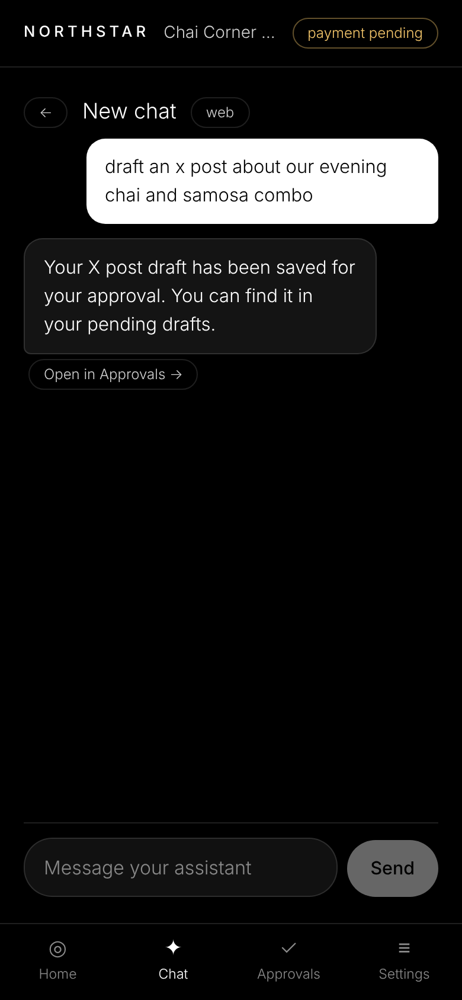 | 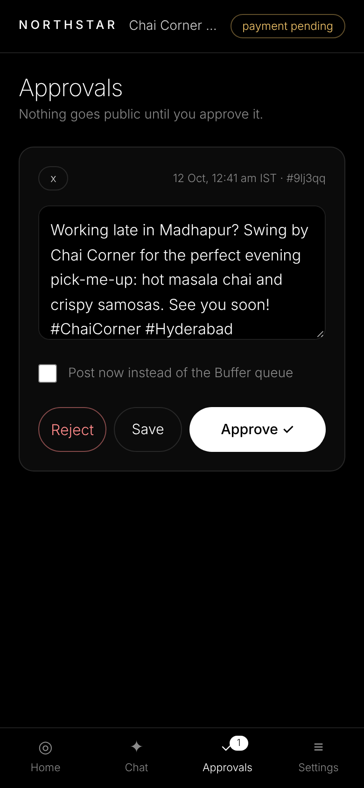 | 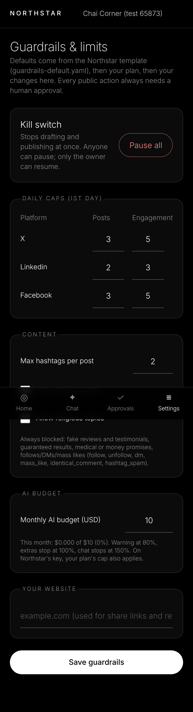 |

<details>
<summary>More screenshots (desktop and onboarding)</summary>

| | |
|---|---|
| 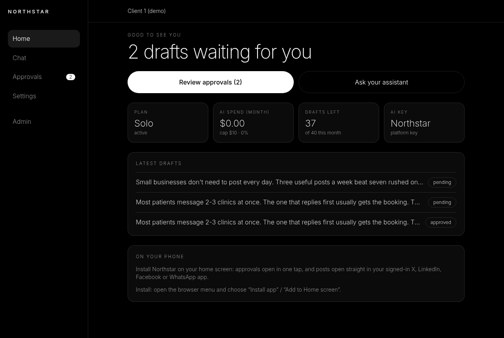 | 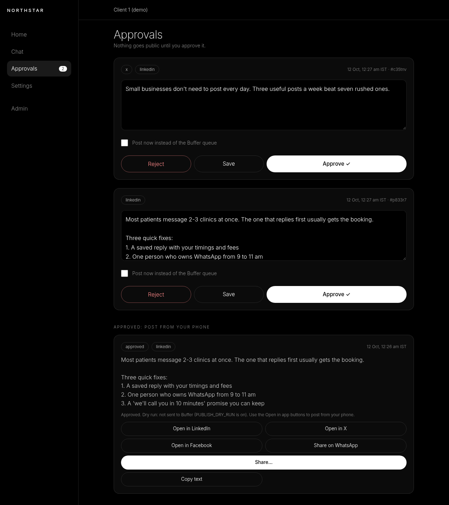 |
| 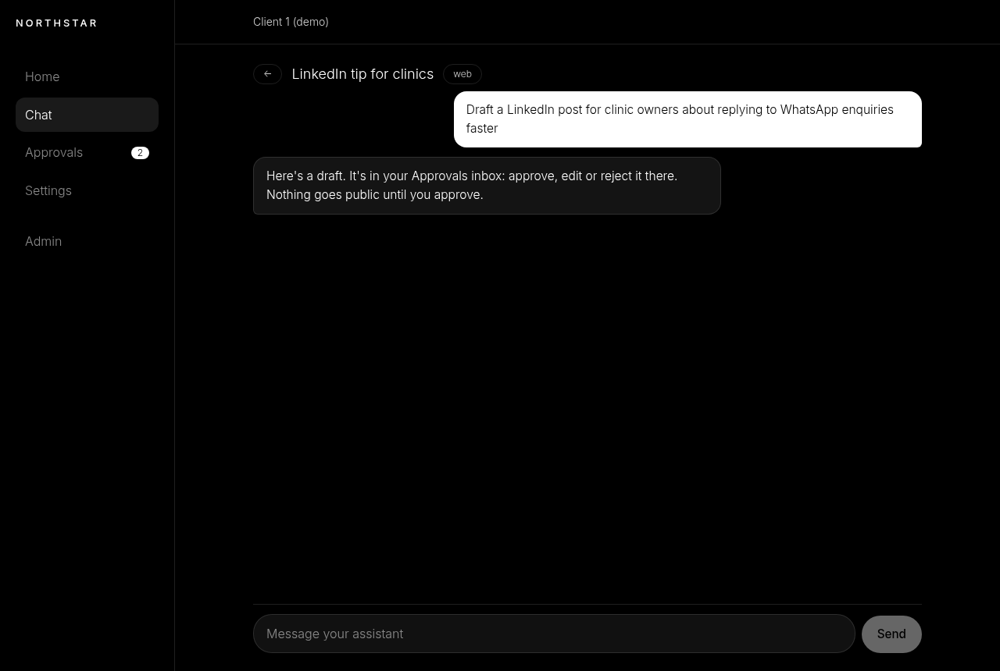 | 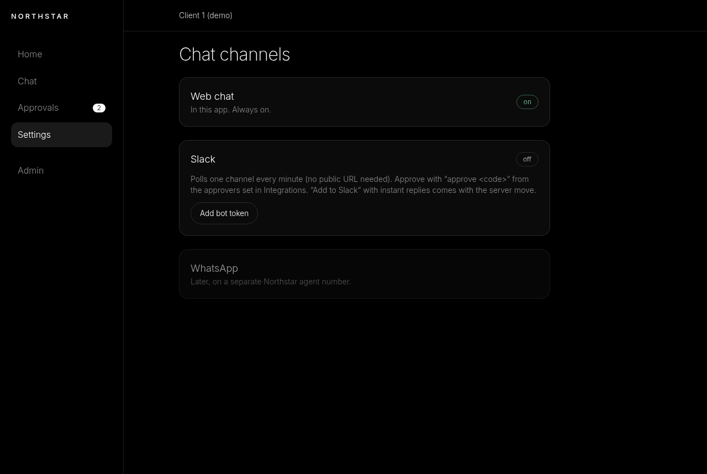 |
| 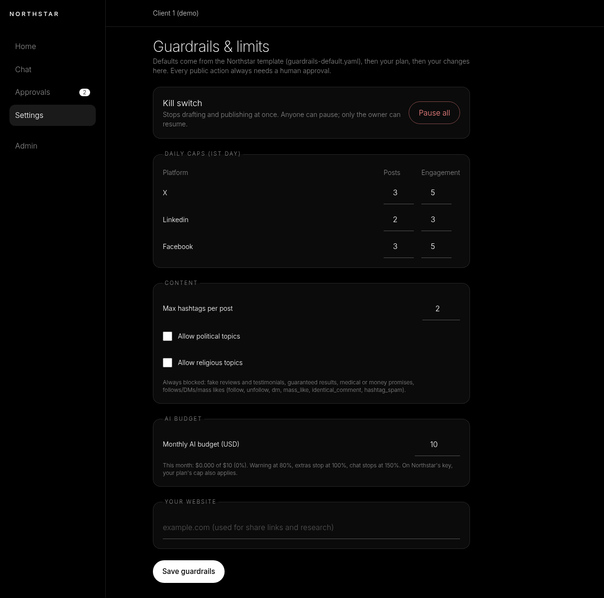 | 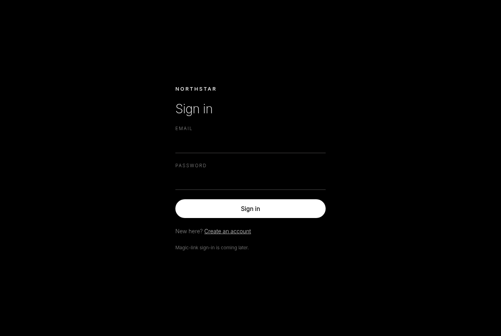 |

| Interview | Connect tools | Chat channel | Dashboard | Approved → open in app |
|---|---|---|---|---|
| 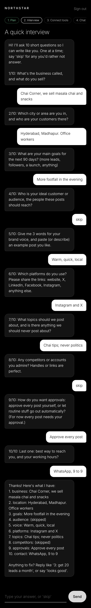 | 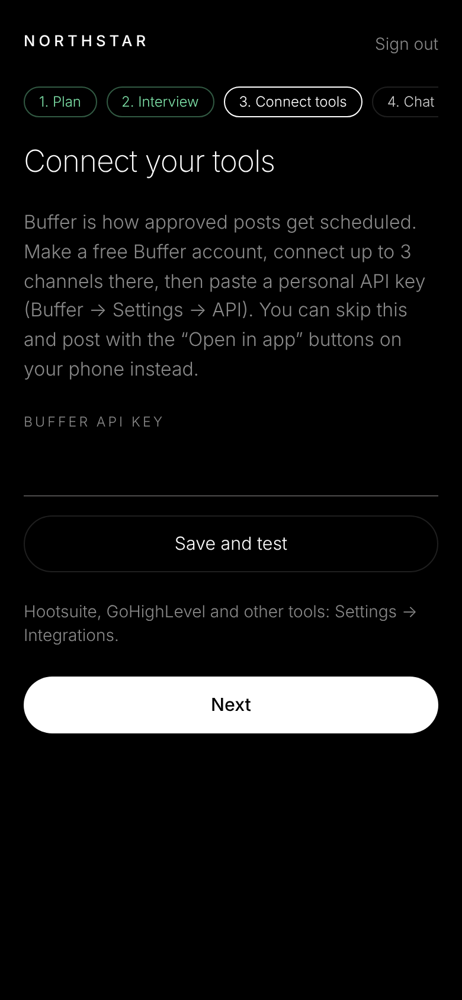 | 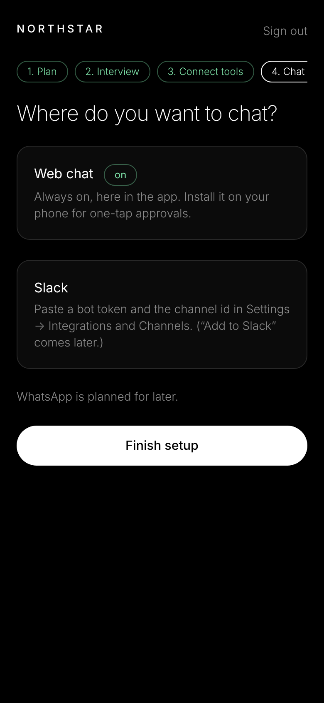 | 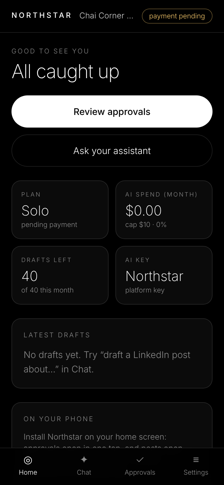 | 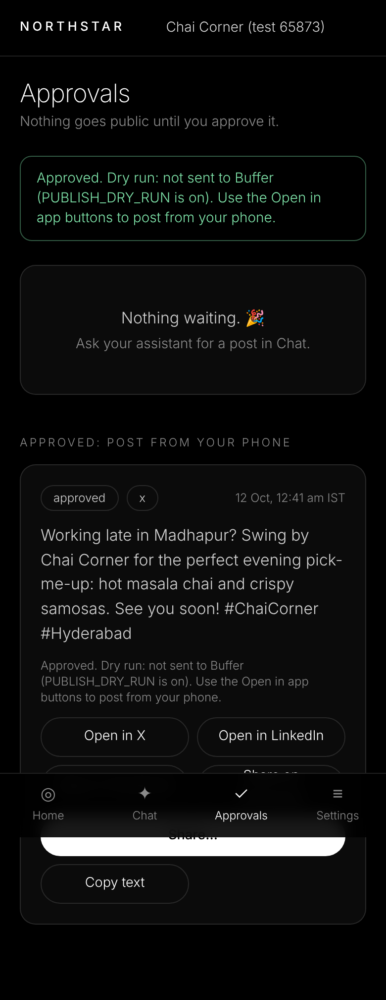 |

The screenshots come from the local demo and use demo data only. The guardrail numbers shown are the demo
workspace's settings, not the plan caps.
</details>

## What works in v0.3.0

**Northstar app** (`app/`, Next.js 15 + Prisma, web + worker)
- Mobile-first installable PWA. Email + password auth, invites with owner/admin/member roles, multi-tenant workspaces and an append-only audit log.
- Onboarding wizard: business → plan → 10-question interview as chat → connect tools → chat channel (web + Slack; Telegram behind a flag).
- Chat with the agent (OpenRouter, platform key or bring-your-own key, encrypted at rest). Drafts land in an approvals inbox.
- Approve as **Buffer queue / post now / at a scheduled time (IST)**. **Buffer OAuth 2.0 + PKCE** and a per-platform channel picker are off until `BUFFER_CLIENT_ID` is set. The personal API key still works.
- **Approve-time content check**: the "numbers must be in notes" rule plus an AI classifier. A blocked draft stays pending with the reason.
- "Open in app" handoff, so the owner can post from their own signed-in X / LinkedIn / Facebook / WhatsApp app.
- Guardrails page (kill switch, daily caps, content rules, AI budget), per-workspace spend caps (80/100/150 %) and a platform-wide daily AI hard stop.
- Slack connector (polling, typed `approve <code>`), tested against a local fake Slack API.
- Admin page: workspaces, mark invoices paid, usage, failed jobs, audit log.
- **Admin Clients dashboard** (v0.3, `/admin/clients`, admin-only, mobile-first): per-client profile links, today's posts/replies/comments against the Viral warm-up caps, and a 7/30-day analytics page (activity per platform, approvals, inbound handled, impressions where available, followers, AI spend vs budget, recent activity). Filled by a read-only collector every 15 min that never calls platform write APIs or the X API.

**Client 1 stack** (the production pilot, run on n8n)
- 14 n8n workflows (exported **inactive**, with no credentials): Slack poller, bot, approvals/commands, hourly approval batches, Viral coach, X engagement drafter, Buffer post tool, browser task tool, onboarding interview.
- `client1-state`: a stdlib-only Python helper for memory, guardrails, approvals, batches and the coach, with offline tests.
- `browser-agent`: a browser-use HTTP service for read-only browsing tasks, with a domain allow-list and metered spend.

**Tests:** 60 vitest tests, typecheck clean, headless E2E 19/19, plus the `client1-state` offline tests.

**Not yet done:** see [app/STATUS.md](app/STATUS.md) and the [roadmap](docs/roadmap.md). Tier caps in the app, real Slack/Buffer runs, web push/email, Postgres and the VPS move are all still to come.

## Architecture

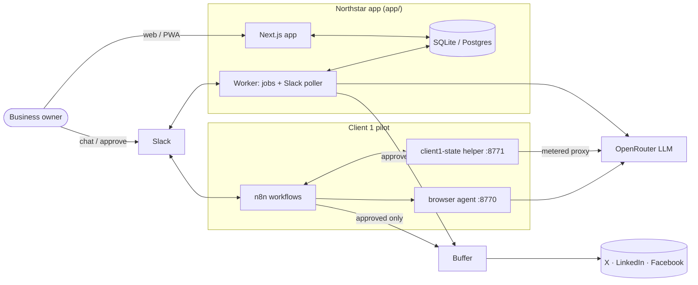

More detail in [docs/architecture.md](docs/architecture.md) and [docs/n8n-workflows.md](docs/n8n-workflows.md).

## Quick start

The full walkthrough is in **[SETUP.md](SETUP.md)** (fresh Linux machine → tests green → app running in dry-run). In short:

```bash
git clone https://github.com/srinivasaphanindra/northstar-agent-stack.git && cd northstar-agent-stack
cd app && cp .env.example .env && chmod 600 .env   # then edit .env as SETUP.md §2 shows
npm ci && npm run typecheck && npm test           # 45 tests
cd .. && bin/northstar-app-up.sh start            # web + worker on 127.0.0.1:3100
```

## Configuration

Each component has a `.env.example`. Copy it to `.env` with `chmod 600` and never commit it. Key app settings:

| Variable | Purpose |
|---|---|
| `APP_URL`, `HOST`, `PORT` | Where the app listens (default `127.0.0.1:3100`) |
| `DATABASE_URL` | SQLite file (absolute path) or Postgres URL |
| `APP_MASTER_KEY` | 32 random bytes. Wraps every workspace's data key. Back it up |
| `OPENROUTER_API_KEY`, `DEFAULT_MODEL`, `LLM_MODE` | AI provider (`auto` / `mock` / `live`) |
| `PUBLISH_DRY_RUN` | `true` = approved drafts are never sent to Buffer |
| `BUFFER_CLIENT_ID`, `BUFFER_CLIENT_SECRET` | Enable "Connect with Buffer" (OAuth + PKCE) |
| `PLATFORM_DAILY_AI_CAP_USD` | Platform-wide daily AI hard stop |
| `CHANNEL_WORKERS`, `CHANNEL_TELEGRAM`, `SLACK_POLL_SECONDS` | Chat channel workers and flags |

The full list (n8n, browser agent and client1-state too) is in [docs/configuration.md](docs/configuration.md).

## Plans and guardrails

| Plan | Price | X | LinkedIn | Facebook | Extras |
|---|---|---|---|---|---|
| **Starter** | ₹4,999 / month | 5 posts + 10 replies a day | 4 posts a week + 2 comments a day | 1 post + 3 comments a day | |
| **Growth** | ₹14,999 / month | 2× Starter | 2× Starter | 2× Starter | |
| **Viral** | ₹24,999 / month | 3× Starter | 3× Starter | 3× Starter | Image creation, support, CRM integration |

These apply to every plan:
- **Approval-gated.** Nothing is posted, replied to or commented without a human OK.
- **4-week warm-up** ramp with pacing (gaps, per-hour limits, quiet hours). Platform warnings pause that platform and step the ramp back.
- **No automated likes, follows or DMs.**
- **Replies only to accounts the client chose or follows.**
- A kill switch, an AI budget and a content check (no fake reviews, guaranteed results, or medical or money promises).

In v0.2.0 the tier caps run in the client 1 n8n stack (`clients/client1/guardrails.yaml`). Porting them into the app is
planned for v0.3. Details: [docs/guardrails.md](docs/guardrails.md).

## Roadmap

v0.3 ports the tier caps, approval batches and the Viral coach into the app. v0.4 adds weekly results reports and inbox-to-lead. v1.0 is the VPS move. See [docs/roadmap.md](docs/roadmap.md).

## FAQ

**Does it post on its own?** No. Every public action needs an approval, and in this repo publishing is also off (`PUBLISH_DRY_RUN=true`).

**Will it like, follow or DM people?** No. Those actions are blocked in the guardrails, not just left out of the prompt.

**Do I need Buffer?** No, but it helps. Without Buffer, approved posts open in your own signed-in app on your phone ("Open in app").

**Which AI model does it use?** It uses OpenRouter, with `google/gemini-3.1-flash-lite` by default. Workspaces can use the platform key or their own key, which is stored encrypted and only the last 4 characters are ever shown.

**WhatsApp? Indian languages?** Both are planned. See [Later in the roadmap](docs/roadmap.md).

**Is it open source?** No. The repository is public to read, but it is proprietary. See [License](#license).

## Contributing and security

See [CONTRIBUTING.md](CONTRIBUTING.md) and [SECURITY.md](SECURITY.md). Please report vulnerabilities privately, not in public issues.

## License

**Proprietary. All rights reserved.** Copyright (c) 2026 Phanindra Malladi. This code may not be copied, reused,
modified, redistributed or resold without written permission. Being publicly visible doesn't grant any license. To ask
for permission, contact the owner through the repository's GitHub profile. See [LICENSE](LICENSE).
