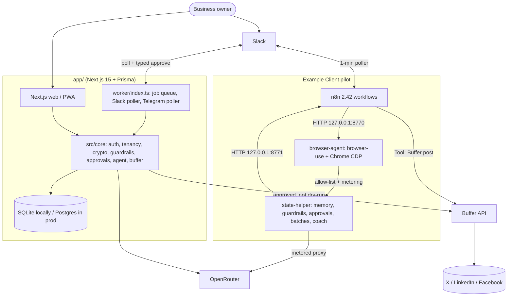

# Architecture

| Component | Path | Role |
|---|---|---|
| Next.js app | `app/src/app`, `app/src/core` | Multi-tenant product: onboarding, chat, approvals, settings, admin. The core is framework-free TypeScript. |
| Worker | `app/worker/` | DB-backed job queue (atomic claim): agent replies, draft notifications, Slack/Telegram polling. |
| n8n workflows | `workflows/client-bot/` | The the example client bot running in production pilot (see [n8n-workflows.md](n8n-workflows.md)). |
| state-helper | `state-helper/` | Python stdlib HTTP helper on 127.0.0.1:8771: memory, guardrails enforcement, approvals, batches, coach, OpenRouter metering. |
| Browser agent | `browser-agent/` | browser-use HTTP service on 127.0.0.1:8770 for read-only browsing tasks. Domain allow-list from state-helper. |
| Buffer | external | Scheduling and publishing. Only reached after approval and when `PUBLISH_DRY_RUN=false`. |
| Slack | external | The owner's chat channel. Polling, so no public URL is needed. |
| OpenRouter | external | LLM provider (default `google/gemini-3.1-flash-lite`). |

## Key design choices
- **Approval gate everywhere.** The agent only creates drafts, and publishing is a separate approved step.
- **Envelope encryption.** `APP_MASTER_KEY` wraps a per-workspace AES-256-GCM data key. Secrets are bound to workspace and purpose (AAD).
- **Local-first.** Every service binds to 127.0.0.1. Slack is polled, so there's no inbound URL until the VPS move (v1.0).
- **Guardrails in code, not prompts.** Caps, warm-up and blocked actions are enforced by `state-helper/guardrails.py` (pilot) and `app/src/core/guardrails.ts` (app).
